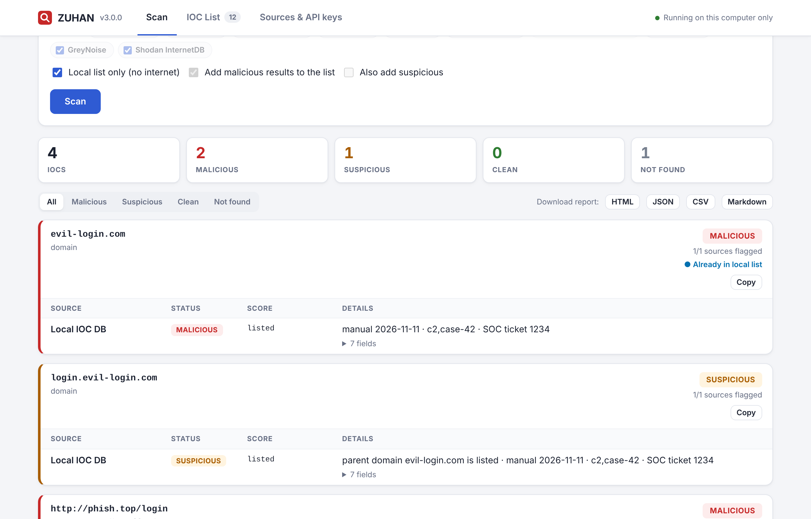
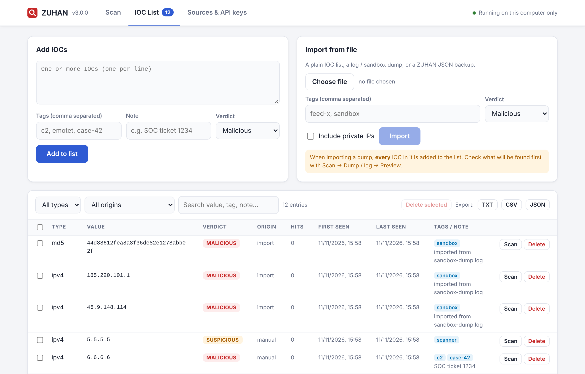
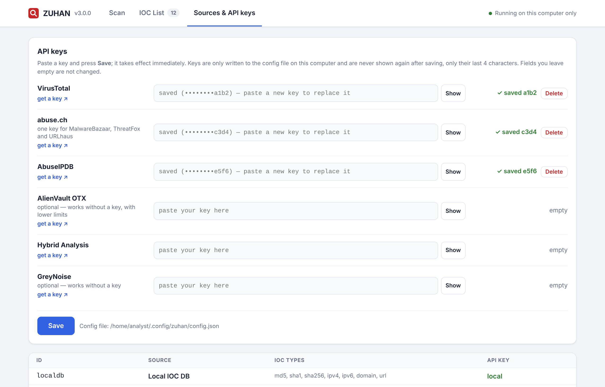

# ZUHAN

**English** · [Türkçe](README_TR.md)

**ZUHAN** looks up Indicators of Compromise (hashes, IPs, domains, URLs) in many
threat-intelligence sources at once, keeps a local list of known-bad IOCs that grows
automatically, and pulls IOCs out of raw dumps such as sandbox API-call traces. You can use it
from the **command line**, from a **browser UI that runs only on your own machine**, or as a
**Go library**.



## Features

- **One query, many sources:** VirusTotal, MalwareBazaar, ThreatFox, URLhaus, AlienVault OTX,
  Hybrid Analysis, AbuseIPDB, GreyNoise and Shodan InternetDB are queried in parallel, and the
  results are merged into one verdict.
- **Local IOC list:** a persistent list of malicious IPs, domains, hashes and URLs. It is
  checked on every scan, and any IOC an external source reports as malicious is **added to it
  automatically**. You can also add, import, search, export and delete entries yourself.
  Subdomains of a listed domain are caught too.
- **IOC extraction from dumps:** paste a sandbox trace, proxy log or JSON API response and the
  IOCs inside it are extracted. Defanged values are refanged, and file names, version strings
  and private IPs are filtered out.
- **Browser UI:** `zuhan web` serves a local-only page where you can scan, manage the list,
  enter API keys and download reports.
- **Reports:** HTML, JSON, Markdown, CSV or plain text.
- **Script-friendly:** exit codes, stdin/stdout piping, and JSON output.
- **Framework:** sources (`Source`) and storage (`Store`) are plain Go interfaces, so you can
  plug in your own intel provider or backend.
- Single static binary with no runtime dependencies. Built only on the Go standard library.

Supported IOC types: **MD5, SHA1, SHA256, IPv4, IPv6, domain, URL**. The type is detected
automatically, and defanged input such as `hxxp://evil[.]com` or `1.2.3[.]4` is accepted.

---

## Contents

1. [Install](#1-install)
2. [Quick start](#2-quick-start)
3. [API keys](#3-api-keys)
4. [Web UI](#4-web-ui)
5. [Scanning from the command line](#5-scanning-from-the-command-line)
6. [Local IOC list](#6-local-ioc-list)
7. [Extracting IOCs from dumps](#7-extracting-iocs-from-dumps)
8. [Reports](#8-reports)
9. [Command reference](#9-command-reference)
10. [How verdicts work](#10-how-verdicts-work)
11. [Troubleshooting](#11-troubleshooting)
12. [Using ZUHAN as a Go library](#12-using-zuhan-as-a-go-library)
13. [Development](#13-development)

---

## 1. Install

### Prebuilt binaries

Download the file for your platform from the **Releases** page:

| Platform | File |
|---|---|
| Linux (x86-64) | `zuhan-linux-amd64` |
| Linux ARM64 (e.g. Raspberry Pi 4/5, 64-bit OS) | `zuhan-linux-arm64` |
| Windows | `zuhan-windows-amd64.exe` (+ `zuhan-web.bat` to start the UI by double-click) |
| macOS (Apple Silicon) | `zuhan-darwin-arm64` |
| macOS (Intel) | `zuhan-darwin-amd64` |

**Linux / macOS**

```bash
mv zuhan-linux-amd64 zuhan          # use your platform's file name
chmod +x zuhan
sudo mv zuhan /usr/local/bin/         # optional: run it from anywhere
zuhan version
```

On macOS, if you get "developer cannot be verified", run `xattr -d com.apple.quarantine zuhan` once.

**Windows:** rename the file to `zuhan.exe` and run it from PowerShell (`.\zuhan.exe version`).
To open the web UI, double-click `zuhan-web.bat`. Double-clicking the `.exe` itself only
flashes a console window.

### With Go (1.22+)

```bash
go install github.com/DNA-Cybertech-Solutions/zuhan/cmd/zuhan@latest
```

### Upgrading from iocscan

ZUHAN was previously called **iocscan**. The command is now `zuhan`, and settings live in
`~/.config/zuhan` (macOS: `~/Library/Application Support/zuhan`, Windows: `%AppData%\zuhan`).
The first time `zuhan` runs, it **copies your API keys and local IOC list** from the old
`iocscan` folder. The old folder is left untouched, and the legacy `IOCSCAN_DB` variable is
still honoured. Exports made with iocscan (`db export`) can be imported as usual.

### From source

```bash
git clone https://github.com/DNA-Cybertech-Solutions/zuhan.git
cd zuhan
make build            # → bin/zuhan
```

---

## 2. Quick start

```bash
zuhan web                                   # open the browser UI, add API keys there
zuhan 44d88612fea8a8f36de82e1278abb02f      # or scan straight from the terminal
```

The hash above is the harmless EICAR test file. VirusTotal flags it in almost every engine,
which makes it a good first test.

---

## 3. API keys

| ID | Source | IOC types | API key |
|---|---|---|---|
| `localdb` (`local`) | Local IOC list | all | not needed |
| `virustotal` (`vt`) | VirusTotal | md5, sha1, sha256, ip, domain, url | required |
| `malwarebazaar` (`mb`) | MalwareBazaar | md5, sha1, sha256 | required (abuse.ch) |
| `threatfox` (`tf`) | ThreatFox | md5, sha256, ipv4, domain, url | required (abuse.ch) |
| `urlhaus` (`uh`) | URLhaus | md5, sha256, ipv4, domain, url | required (abuse.ch) |
| `otx` | AlienVault OTX | md5, sha1, sha256, ip, domain, url | optional |
| `hybrid` (`ha`) | Hybrid Analysis | md5, sha1, sha256 | required |
| `abuseipdb` | AbuseIPDB | ipv4, ipv6 | required |
| `greynoise` (`gn`) | GreyNoise Community | ipv4 | optional |
| `shodan` | Shodan InternetDB | ipv4 | not needed |

Every provider has a free tier. A single abuse.ch key covers MalwareBazaar, ThreatFox and
URLhaus. Sources without a key are shown as `SKIPPED`, and the scan still runs.

**Easiest:** run `zuhan web`, open **Sources & API keys**, paste each key and press **Save**.
Keys take effect immediately, and every source has a "get a key" link.

**Config file:** `zuhan init` creates an empty file. Fill it in with a text editor:

| OS | Path |
|---|---|
| Linux | `~/.config/zuhan/config.json` |
| macOS | `~/Library/Application Support/zuhan/config.json` |
| Windows | `%AppData%\zuhan\config.json` |

```json
{
  "virustotal": "",
  "abuseipdb": "",
  "otx": "",
  "abusech": "",
  "greynoise": "",
  "hybrid_analysis": ""
}
```

**Environment variables** override the file: `VT_API_KEY`, `ABUSECH_API_KEY`,
`ABUSEIPDB_API_KEY`, `OTX_API_KEY`, `HYBRID_API_KEY`, `GREYNOISE_API_KEY`.

Run `zuhan sources` to see which keys are configured.

> The config file and the IOC list are written with `0600` permissions. Never commit
> `config.json`; the repository's `.gitignore` already excludes it.

---

## 4. Web UI

```bash
zuhan web
```

This opens `http://127.0.0.1:8787` in your browser. The UI keeps running while the terminal
window is open. Press **Ctrl+C** in that window to stop it.

| Tab | What you can do |
|---|---|
| **Scan** | Scan IOCs you paste in, a dump or log (with a preview first), or files you drop in (they are hashed locally). Pick sources, run in offline mode, filter results, add a result to the list with one click, and **download an HTML / JSON / CSV / Markdown report**. |
| **IOC List** | Add IOCs with tags, a note and a verdict, import from a file, filter by type, origin or text, delete one or many, re-scan an entry, and export as TXT / CSV / JSON. |
| **Sources & API keys** | Enter, replace or delete API keys (they take effect immediately), and see which sources are active and where the files are. |



The UI uses the same config and the same IOC list as the CLI.

**Security**

- The server only listens on a loopback address (`127.0.0.1` / `::1`). Any other address is refused.
- The `Host` header is checked on every request, which blocks DNS rebinding.
- Every API call needs a random token that is generated on each start and is only embedded in
  the page itself. Other websites open in your browser therefore cannot call the API.
- Saved API keys are never sent back to the browser; only their last 4 characters are shown.
- Files you drop in are hashed locally and are not uploaded anywhere.

Options: `-addr 127.0.0.1:9000` (if 8787 is busy, a free port is picked automatically),
`-no-open`, `-db <file>`, `-c <config>`.



---

## 5. Scanning from the command line

> `<hash>`, `<ip>` etc. are placeholders. Type the value itself, without the `<` `>`.
> Quote URLs so your shell leaves `?`, `&` and `[ ]` alone.

```bash
zuhan 44d88612fea8a8f36de82e1278abb02f          # a hash
zuhan 185.220.101.1 evil-domain.com             # several at once
zuhan "hxxp://bad[.]site/payload.exe"           # defanged URL
zuhan -v <hash>                                 # every field + links
zuhan -f iocs.txt                               # one IOC per line, '#' comments
zuhan -hash sample.exe                          # hash a file and look it up
cat iocs.txt | zuhan -o json                    # pipe in, JSON out
zuhan -s vt,mb,tf <hash>                        # only these sources
zuhan -x shodan,greynoise <ip>                  # all but these
zuhan -offline <ioc>                            # local list only, no internet
```

`zuhan <ioc>` is the same as `zuhan scan <ioc>`.

---

## 6. Local IOC list

The local list is the persistent list of known-bad indicators.

- It is the **first source checked** on every scan (`Local IOC DB`) and answers instantly, without network access.
- When any external source says an IOC is **malicious**, the IOC is added automatically
  (`origin: auto`) together with the names of the sources that flagged it. Use `-no-save` to
  disable this and `-save-suspicious` to also keep suspicious results.
- When a file scanned with `-hash` is malicious, its MD5, SHA1 and SHA256 are all added.
- If `evil.com` is listed, `login.evil.com` is reported as **suspicious** and
  `http://evil.com/x` as **malicious**.
- Entries are never removed or downgraded automatically.

The list lives next to the config (`~/.config/zuhan/iocdb.json`; see `zuhan db path`).
Use `-db <file>` or `ZUHAN_DB` to keep a separate list per case, for example.

```bash
# add (no arguments = interactive prompt)
zuhan db add evil.com 6.6.6.6 "hxxp://phish[.]top/login" -tag c2,case-42 -note "ticket 1234"
zuhan db add sus.example -verdict suspicious
zuhan db add

# list / search
zuhan db list
zuhan db list -type ip              # ip = ipv4+ipv6, hash = md5+sha1+sha256
zuhan db list -origin auto          # added automatically by scans
zuhan db list -search case-42 -o json
zuhan db stats

# remove
zuhan db rm evil.com 6.6.6.6

# import: plain lists, dumps, or another zuhan JSON export
zuhan db import feed.txt -tag feed-x
zuhan db import sandbox.log -tag sandbox -type ip,domain
zuhan db import backup.json

# export: blocklists or full backup (format from extension or -o)
zuhan db export ip-blocklist.txt -type ip
zuhan db export backup.json
zuhan db export -type hash          # to stdout
```

> Importing a dump adds **every** IOC found in it. Run `zuhan extract <file>` first to see what will be added.

---

## 7. Extracting IOCs from dumps

```bash
zuhan extract sandbox-dump.log                 # list only, no lookups
zuhan extract dump.json -o txt                 # one per line, for piping
zuhan scan -dump sandbox-dump.log              # extract + look up everything
zuhan scan -dump dump.log -r report.html       # … and write a report
cat trace.txt | zuhan scan -dump -             # from stdin
```

From [`examples/sandbox-dump.log`](examples/sandbox-dump.log), the extractor returns:

```
md5     44d88612fea8a8f36de82e1278abb02f
url     http://update-check.xyz/gate.php?id=42
url     https://evil.example.ru/payload.bin
domain  update-check.xyz
domain  cdn.bad-domain.top
domain  evil.example.ru
ipv4    185.220.101.1
ipv4    45.9.148.114
```

The extractor:

- refangs (`hxxp`, `[.]`, `[:]`, `(dot)`…) and un-escapes JSON `\/`;
- ignores file names that look like domains (`kernel32.dll`, `invoice.pdf.exe`, `collect.py`);
- ignores version numbers and all-zero hashes;
- skips private, loopback, link-local and CGNAT IPs unless you pass `-keep-private`.

`scan -dump` looks up **at most 100 IOCs** by default so free API quotas are not exhausted
(VirusTotal's free tier allows 4 requests/minute). Change this with `-max 300`, or use `-max 0`
for no limit.

---

## 8. Reports

Add `-r <file>`; the format comes from the extension:

| Extension | Use |
|---|---|
| `.html` | shareable, colour-coded report for the browser |
| `.json` | SIEM / SOAR / other tools |
| `.md` | tickets, wikis |
| `.csv` | spreadsheets |
| `.txt` | same as the terminal table |

```bash
zuhan -f iocs.txt -r report.html
zuhan scan -dump dump.log -r report.json -q     # write the report, print nothing
zuhan <hash> -o json                            # JSON to stdout instead
```

In the web UI, use the **Download report** buttons above the results.

---

## 9. Command reference

| Command | Description |
|---|---|
| `zuhan [scan] <ioc> ...` | look up IOCs |
| `zuhan scan -dump <file>` | extract IOCs from a dump and look them up |
| `zuhan extract <file>` | list the IOCs in a dump |
| `zuhan db add\|rm\|list\|import\|export\|stats\|path` | manage the local IOC list |
| `zuhan web` | start the local browser UI |
| `zuhan sources` | sources and API key status |
| `zuhan init` | create an empty config file |
| `zuhan version` | print the version |

Every command has its own help: `zuhan scan -h`, `zuhan db add -h`, …
Flags may come before or after arguments.

### `scan` flags

| Flag | Description | Default |
|---|---|---|
| `-v` | show every field and link | off |
| `-f file` | IOC list file | — |
| `-dump file` | extract IOCs from a dump and look them up (`-` = stdin) | — |
| `-max n` | max IOCs from a dump (0 = unlimited) | `100` |
| `-keep-private` | keep private IPs from dumps | off |
| `-hash` | hash file arguments and look up the hashes | off |
| `-r file` | write a report (format from extension) | — |
| `-o format` | stdout format: `table`, `json`, `md`, `csv`, `html` | `table` |
| `-s list` | only these sources, e.g. `local,vt,mb` | all |
| `-x list` | exclude these sources | — |
| `-offline` | local list only | off |
| `-no-save` | don't add malicious results to the local list | off |
| `-save-suspicious` | also add suspicious results | off |
| `-db file` | use another IOC list file | `~/.config/zuhan/iocdb.json` |
| `-t duration` | timeout per source | `25s` |
| `-p n` | IOCs processed in parallel (lower it if you hit rate limits) | `4` |
| `-c file` | use another config file | — |
| `-q` | print nothing (use with `-r` / exit codes) | off |
| `-no-color` | disable colours (`NO_COLOR` also works) | — |

### `db` flags

| Flag | Commands | Description |
|---|---|---|
| `-tag a,b` | add, import | tags |
| `-note "…"` | add, import | note |
| `-verdict` | add, import | `malicious` (default) or `suspicious` |
| `-type` | list, export, import | `md5,sha1,sha256,hash,ipv4,ipv6,ip,domain,url` |
| `-origin` | list, export | `manual`, `auto`, `import` |
| `-search` | list, export | search value, tags, note, sources |
| `-o` | list, export | `table`, `txt`, `json`, `csv` |
| `-keep-private` | import | keep private IPs |
| `-db file` | all | use another list file |

### Exit codes

| Code | Meaning |
|---|---|
| `0` | nothing malicious or suspicious |
| `1` | error |
| `2` | at least one IOC is malicious |
| `3` | at least one IOC is suspicious (none malicious) |

```bash
zuhan -q -offline 1.2.3.4 && echo clean || echo "attention (exit $?)"
```

---

## 10. How verdicts work

Each source's answer is normalised to `MALICIOUS`, `SUSPICIOUS`, `CLEAN`, `INFO`, `NOT FOUND`,
`SKIPPED` or `ERROR`. An IOC's overall **verdict** is the most severe of these, and
`x/y sources flagged` shows how many of the sources that answered called it malicious or
suspicious.

| Source | Rule |
|---|---|
| Local IOC DB | stored verdict; a parent-domain match → suspicious |
| VirusTotal | 3+ engines → malicious, 2 → suspicious, a single engine → clean with a "likely false positive" note (suspicious if the VT reputation is negative) |
| AbuseIPDB | confidence ≥ 75 → malicious, ≥ 25 → suspicious |
| MalwareBazaar / ThreatFox / URLhaus | listed → malicious |
| AlienVault OTX | malware family or 5+ pulses → malicious, 1–4 pulses → suspicious, real allow-lists (whitelist, Alexa, Majestic, known false positive…) → clean |
| GreyNoise | by classification; RIOT (known benign service) → clean |
| Hybrid Analysis | sandbox verdict |
| Shodan InternetDB | informational (ports/CVEs); suspicious only with `c2`/`malware`/`compromised` tags |

> Brand-new samples may not be on VirusTotal yet. The EICAR test file is not real malware, so
> MalwareBazaar, ThreatFox and URLhaus return `NOT FOUND` for it. Tor exit nodes are flagged
> malicious by most sources, so decide whether you want them in your blocklist.

---

## 11. Troubleshooting

| Problem | Fix |
|---|---|
| `No such file or directory` | The file is still named `zuhan-linux-amd64`, or you are in another folder. Check with `ls`, rename it with `mv`, and `cd` into its folder. |
| `Permission denied` | `chmod +x zuhan` |
| `syntax error near unexpected token 'newline'` | You typed the `<` `>` placeholders. |
| `virustotal:: command not found` | You pasted JSON into the terminal. Edit the config with a text editor, or use the web UI. |
| `web` is treated as an IOC / old usage text | You are running an old binary. `zuhan version` should print 3.0.0 or later. |
| `HTTP 401/403` | Wrong or incomplete key. Check `zuhan sources`. |
| `HTTP 429: rate limit exceeded` | Free-tier quota. Use `-p 1`, a lower `-max`, or wait. |
| `timeout` | Slow network. Try `-t 60s`. |
| `IOC db … is corrupt` | The list was edited by hand. Fix the JSON, or restore it with `db import backup.json`. |

---

## 12. Using ZUHAN as a Go library

| Package | Contents |
|---|---|
| `github.com/DNA-Cybertech-Solutions/zuhan` | `Scanner`: sources + local list + engine, with auto-save |
| `pkg/ioc` | IOC types, detection, refang |
| `pkg/sources` | `Source` interface and built-in providers |
| `pkg/store` | `Store` interface, JSON `FileStore`, `LocalSource`, import/export |
| `pkg/extract` | IOC extraction from free text |
| `pkg/engine` | parallel lookups, verdict merging |
| `pkg/report` | table / JSON / Markdown / CSV / HTML renderers |
| `pkg/web` | the browser UI and its JSON API |
| `pkg/config` | config file and environment variables |

A source is any type with six methods:

```go
type Source interface {
    ID() string
    Name() string
    Supports(t ioc.Type) bool
    RequiresKey() bool
    Configured() bool
    Query(ctx context.Context, i ioc.IOC) sources.Result
}
```

```go
st, _ := store.Open(config.DBPath(""))
keys, _, _ := config.Load("")
sc := zuhan.New(keys, st)                 // local list + built-in sources
sc.Use(&CompanyBlocklist{Path: "blocklist.txt"})
reps, skipped, err := sc.ScanValues(ctx, "8.8.8.8", "evil.com")
reps, extracted, err := sc.ScanDump(ctx, file, extract.Options{Max: 100})
```

A complete runnable example is in [`examples/custom-source`](examples/custom-source/main.go):

```bash
go run ./examples/custom-source 1.2.3.4 evil.com
```

To use another storage backend (SQLite, Redis, MISP…), implement `store.Store`
(`Get`, `Put`, `Touch`, `Delete`, `List`).

---

## 13. Development

```bash
make test        # go vet + race-enabled tests (no network needed)
make lint        # gofmt check
make build       # bin/zuhan
make web         # build + start the UI
make release     # cross-compile every platform into dist/ with SHA256SUMS
```

The tests use fake HTTP servers, so no API keys or internet access are needed.
GitHub Actions run the tests on every push. Pushing a tag such as `v3.0.0` builds every
platform and publishes a GitHub Release automatically.

```
.
├── cmd/zuhan/          CLI: scan, extract, db, web
├── pkg/
│   ├── ioc/              type detection, refang
│   ├── sources/          VirusTotal, abuse.ch, OTX, AbuseIPDB, GreyNoise, Shodan, Hybrid Analysis
│   ├── store/            local IOC list
│   ├── extract/          IOC extraction from dumps
│   ├── engine/           parallel lookups
│   ├── report/           output formats
│   ├── web/              browser UI (index.html is embedded in the binary)
│   └── config/           config + environment
├── scanner.go            Scanner (framework entry point)
├── examples/             sample config, IOC list, sandbox dump, custom source
├── scripts/              zuhan-web.bat (Windows launcher)
└── docs/screenshots/
```

See [CHANGELOG.md](CHANGELOG.md) for version history.

## Disclaimer

Verdicts come from third-party services and can be wrong in both directions. Validate them
before blocking or attributing anything, and respect each provider's terms of use and rate
limits.
