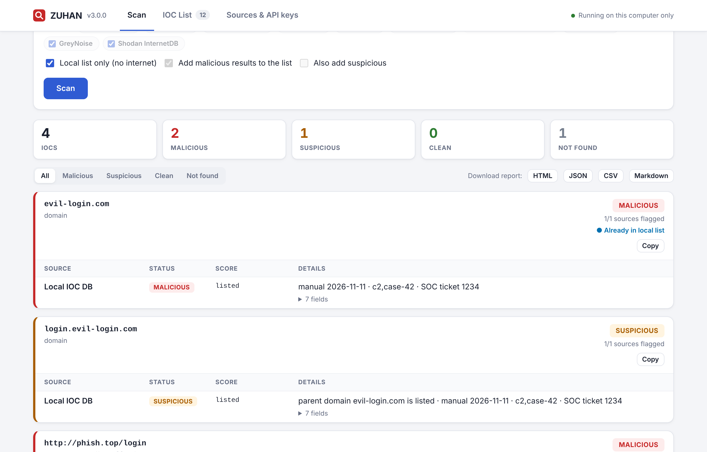
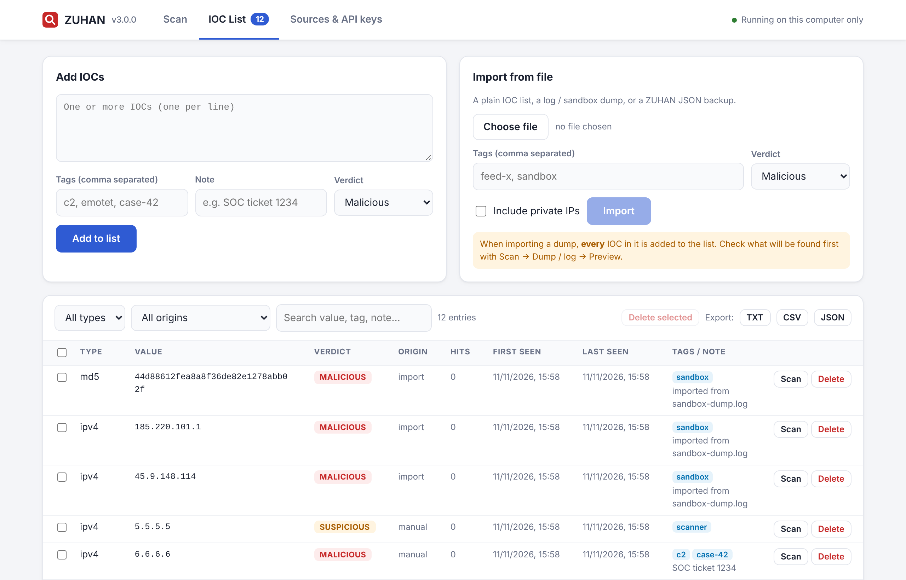
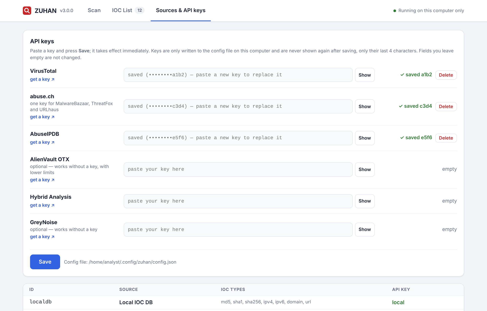

# ZUHAN

[English](README.md) · **Türkçe**

**ZUHAN**, IOC'leri (Indicator of Compromise: hash, IP, domain, URL) birden fazla tehdit
istihbaratı kaynağında aynı anda sorgular. Zararlı olduğu bilinen IOC'leri kendiliğinden büyüyen
bir yerel listede tutar ve sandbox API çağrı dökümü gibi ham metinlerin içinden IOC ayıklar.
Üç şekilde kullanılabilir: **komut satırından**, **sadece kendi bilgisayarında çalışan bir
tarayıcı arayüzünden** ya da bir **Go kütüphanesi** olarak.



## Özellikler

- **Tek sorgu, çok kaynak:** VirusTotal, MalwareBazaar, ThreatFox, URLhaus, AlienVault OTX,
  Hybrid Analysis, AbuseIPDB, GreyNoise ve Shodan InternetDB aynı anda sorgulanır, sonuçlar tek
  bir kararda birleştirilir.
- **Yerel IOC listesi:** zararlı IP, domain, hash ve URL'lerin kalıcı listesi. Her taramada bu
  listeye de bakılır. Bir dış kaynağın zararlı dediği IOC listeye **otomatik eklenir**. Listeye
  elle ekleme, içe aktarma, arama, dışa aktarma ve silme de yapılabilir. Listedeki bir domain'in
  alt alan adları da yakalanır.
- **Dökümden IOC çıkarma:** sandbox trace'i, proxy logu ya da JSON API yanıtı yapıştırılır,
  içindeki IOC'ler ayıklanır. Defang edilmiş değerler düzeltilir; dosya adları, sürüm numaraları
  ve özel IP'ler elenir.
- **Tarayıcı arayüzü:** `zuhan web` ile sadece bu bilgisayarda çalışan bir sayfa açılır.
  Sorgulama, liste yönetimi, API key girişi ve rapor indirme oradan yapılır. Arayüz ve komut satırı İngilizcedir.
- **Rapor:** HTML, JSON, Markdown, CSV ya da düz metin.
- **Script dostu:** çıkış kodları, stdin/stdout ile pipe, JSON çıktı.
- **Framework:** kaynak (`Source`) ve depolama (`Store`) birer Go arayüzüdür. Kendi istihbarat
  kaynağınızı ya da depolama altyapınızı ekleyebilirsiniz.
- Tek dosyalık binary, çalışması için başka bir şey gerekmez. Sadece Go standart kütüphanesi kullanılır.

Desteklenen IOC tipleri: **MD5, SHA1, SHA256, IPv4, IPv6, domain, URL**. Tip otomatik tanınır.
`hxxp://evil[.]com` ya da `1.2.3[.]4` gibi defang edilmiş girdiler de kabul edilir.

---

## İçindekiler

1. [Kurulum](#1-kurulum)
2. [Hızlı başlangıç](#2-hızlı-başlangıç)
3. [API key'ler](#3-api-keyler)
4. [Tarayıcı arayüzü](#4-tarayıcı-arayüzü)
5. [Komut satırından sorgulama](#5-komut-satırından-sorgulama)
6. [Yerel IOC listesi](#6-yerel-ioc-listesi)
7. [Dökümden IOC çıkarma](#7-dökümden-ioc-çıkarma)
8. [Rapor alma](#8-rapor-alma)
9. [Komut referansı](#9-komut-referansı)
10. [Kararlar nasıl veriliyor](#10-kararlar-nasıl-veriliyor)
11. [Sık karşılaşılan hatalar](#11-sık-karşılaşılan-hatalar)
12. [Go kütüphanesi olarak kullanma](#12-go-kütüphanesi-olarak-kullanma)
13. [Geliştirme](#13-geliştirme)

---

## 1. Kurulum

### Hazır binary

**Releases** sayfasından sisteminize uygun dosyayı indirin:

| Sistem | Dosya |
|---|---|
| Linux (x86-64) | `zuhan-linux-amd64` |
| Linux ARM64 (ör. Raspberry Pi 4/5, 64-bit işletim sistemi) | `zuhan-linux-arm64` |
| Windows | `zuhan-windows-amd64.exe` (+ arayüzü çift tıkla açmak için `zuhan-web.bat`) |
| macOS (Apple Silicon) | `zuhan-darwin-arm64` |
| macOS (Intel) | `zuhan-darwin-amd64` |

**Linux / macOS**

```bash
mv zuhan-linux-amd64 zuhan          # kendi sisteminizin dosya adını yazın
chmod +x zuhan
sudo mv zuhan /usr/local/bin/         # opsiyonel: her klasörden çalıştırmak için
zuhan version
```

macOS "geliştirici doğrulanamadı" derse bir kez `xattr -d com.apple.quarantine zuhan` çalıştırın.

> `/usr/local/bin`'e taşımadıysanız bu README'deki komutların başına `./` ekleyin
> (`./zuhan version`) ve binary'nin olduğu klasörde çalıştırın.

**Windows:** dosyanın adını `zuhan.exe` yapın ve PowerShell'den çalıştırın (`.\zuhan.exe version`).
Arayüzü açmak için `zuhan-web.bat` dosyasına çift tıklayın. `.exe`'ye çift tıklarsanız pencere
açılıp hemen kapanır.

### Go ile (1.22+)

```bash
go install github.com/DNA-Cybertech-Solutions/zuhan/cmd/zuhan@latest
```

### iocscan'den geçiş

ZUHAN'ın eski adı **iocscan**'di. Komut artık `zuhan`, ayarlar da `~/.config/zuhan` klasöründe
(macOS: `~/Library/Application Support/zuhan`, Windows: `%AppData%\zuhan`). `zuhan` ilk
çalıştığında **API key'lerinizi ve yerel IOC listenizi** eski `iocscan` klasöründen kopyalar.
Eski klasöre dokunulmaz, eski `IOCSCAN_DB` değişkeni de hâlâ geçerlidir. iocscan ile alınmış
yedekler (`db export`) normal şekilde import edilebilir.

### Kaynaktan derleme

```bash
git clone https://github.com/DNA-Cybertech-Solutions/zuhan.git
cd zuhan
make build            # → bin/zuhan
```

---

## 2. Hızlı başlangıç

```bash
zuhan web                                   # tarayıcı arayüzünü aç, API key'leri oradan gir
zuhan 44d88612fea8a8f36de82e1278abb02f      # ya da doğrudan terminalden sorgula
```

Yukarıdaki hash zararsız EICAR test dosyasına ait. VirusTotal'daki motorların neredeyse hepsi
onu zararlı işaretler, ilk test için uygundur.

---

## 3. API key'ler

| ID | Kaynak | IOC tipleri | API key |
|---|---|---|---|
| `localdb` (`local`) | Yerel IOC listesi | hepsi | gerekmez |
| `virustotal` (`vt`) | VirusTotal | md5, sha1, sha256, ip, domain, url | gerekli |
| `malwarebazaar` (`mb`) | MalwareBazaar | md5, sha1, sha256 | gerekli (abuse.ch) |
| `threatfox` (`tf`) | ThreatFox | md5, sha256, ipv4, domain, url | gerekli (abuse.ch) |
| `urlhaus` (`uh`) | URLhaus | md5, sha256, ipv4, domain, url | gerekli (abuse.ch) |
| `otx` | AlienVault OTX | md5, sha1, sha256, ip, domain, url | opsiyonel |
| `hybrid` (`ha`) | Hybrid Analysis | md5, sha1, sha256 | gerekli |
| `abuseipdb` | AbuseIPDB | ipv4, ipv6 | gerekli |
| `greynoise` (`gn`) | GreyNoise Community | ipv4 | opsiyonel |
| `shodan` | Shodan InternetDB | ipv4 | gerekmez |

Kaynakların hepsinin ücretsiz katmanı var. Tek bir abuse.ch key'i MalwareBazaar, ThreatFox ve
URLhaus'un üçü için de geçerli. Key'i olmayan kaynak `SKIPPED` olarak gösterilir, tarama durmaz.

**En kolayı:** `zuhan web` çalıştırın, **Sources & API keys** sekmesine geçin, key'leri yapıştırıp
**Save**'e basın. Key'ler hemen devreye girer. Her kaynağın yanında key alma linki ("get a key") vardır.

**Config dosyası:** `zuhan init` boş bir dosya oluşturur. Bu dosyayı bir **metin editörüyle**
doldurun. JSON'u terminale yapıştırmayın.

| Sistem | Yol |
|---|---|
| Linux | `~/.config/zuhan/config.json` |
| macOS | `~/Library/Application Support/zuhan/config.json` |
| Windows | `%AppData%\zuhan\config.json` |

```json
{
  "virustotal": "",
  "abuseipdb": "",
  "otx": "",
  "abusech": "",
  "greynoise": "",
  "hybrid_analysis": ""
}
```

**Ortam değişkenleri** config dosyasındaki değeri ezer: `VT_API_KEY`, `ABUSECH_API_KEY`,
`ABUSEIPDB_API_KEY`, `OTX_API_KEY`, `HYBRID_API_KEY`, `GREYNOISE_API_KEY`.

Hangi key'lerin tanımlı olduğunu görmek için `zuhan sources` çalıştırın.

> Config dosyası ve IOC listesi `0600` izinle yazılır, yani sadece siz okuyabilirsiniz.
> `config.json` dosyasını asla repoya eklemeyin. `.gitignore` bunu zaten engelliyor.

---

## 4. Tarayıcı arayüzü

```bash
zuhan web
```

Bu komut tarayıcıda `http://127.0.0.1:8787` adresini açar. Arayüz, terminal penceresi açık
kaldığı sürece çalışır. Kapatmak için o pencerede **Ctrl+C**'ye basın.

| Sekme | Ne yapılır |
|---|---|
| **Scan** | Yapıştırılan IOC'leri, bir döküm ya da logu (önce önizleme ile) veya sürüklenen dosyaları (bu bilgisayarda hash'lenir) sorgulama. Kaynak seçme, offline mod, sonuçları filtreleme, bir sonucu tek tıkla listeye ekleme ve **HTML / JSON / CSV / Markdown rapor indirme**. |
| **IOC List** | Etiket, not ve kararla IOC ekleme, dosyadan içe aktarma, tipe, kaynağa ya da metne göre filtreleme, tekli ya da toplu silme, bir kaydı tekrar sorgulama, TXT / CSV / JSON dışa aktarma. |
| **Sources & API keys** | API key girme, değiştirme ve silme (hemen devreye girer). Hangi kaynakların aktif olduğu ve dosyaların yeri. |



Arayüz CLI ile **aynı config dosyasını ve aynı IOC listesini** kullanır.

**Güvenlik**

- Sunucu sadece loopback adresinde (`127.0.0.1` / `::1`) dinler. Başka bir adres verilirse çalışmayı reddeder.
- Her istekte `Host` başlığı kontrol edilir. Bu, DNS rebinding saldırılarını engeller.
- Her API isteği, her açılışta rastgele üretilen ve sadece sayfanın içine gömülen bir anahtar
  ister. Bu sayede tarayıcıda açık olan başka siteler arayüze istek gönderemez.
- Kaydedilen API key'ler tarayıcıya geri gönderilmez, sadece son 4 karakteri gösterilir.
- Sürüklenen dosyalar bu bilgisayarda hash'lenir, hiçbir yere yüklenmez.

Seçenekler: `-addr 127.0.0.1:9000` (8787 doluysa otomatik olarak boş bir port seçilir),
`-no-open`, `-db <dosya>`, `-c <config>`.



---

## 5. Komut satırından sorgulama

> `<hash>`, `<ip>` gibi ifadeler **yer tutucudur**. `<` ve `>` yazmayın, gerçek değeri koyun.
> URL'leri **tırnak içinde** yazın, yoksa shell `?`, `&` ve `[ ]` karakterlerini yorumlar.

```bash
zuhan 44d88612fea8a8f36de82e1278abb02f          # hash
zuhan 185.220.101.1 evil-domain.com             # birden fazla
zuhan "hxxp://bad[.]site/payload.exe"           # defang edilmiş URL
zuhan -v <hash>                                 # tüm alanlar + linkler
zuhan -f iocs.txt                               # satır başına bir IOC, '#' yorum
zuhan -hash ornek.exe                           # dosyanın hash'ini hesapla ve sorgula
cat iocs.txt | zuhan -o json                    # pipe ile gir, JSON al
zuhan -s vt,mb,tf <hash>                        # sadece bu kaynaklar
zuhan -x shodan,greynoise <ip>                  # bunlar hariç hepsi
zuhan -offline <ioc>                            # sadece yerel liste, internete çıkma
```

`zuhan <ioc>` ile `zuhan scan <ioc>` aynı şeydir.

---

## 6. Yerel IOC listesi

Yerel liste, zararlı olduğu bilinen IOC'lerin kalıcı olarak tutulduğu listedir.

- Her taramada **ilk bakılan kaynaktır** (`Local IOC DB`). İnternete çıkmadan anında cevap verir.
- Bir dış kaynak bir IOC'ye **zararlı** derse IOC listeye **otomatik eklenir** (`origin: auto`).
  Hangi kaynakların işaretlediği de kaydedilir. Bunu kapatmak için `-no-save`, şüphelileri de
  eklemek için `-save-suspicious` kullanın.
- `-hash` ile taranan dosya zararlı çıkarsa MD5, SHA1 ve SHA256 değerlerinin üçü de eklenir.
- `evil.com` listedeyse `login.evil.com` **şüpheli**, `http://evil.com/x` **zararlı** görünür.
- Kayıtlar otomatik olarak silinmez ya da düşürülmez.

Liste config dosyasının yanındadır (`~/.config/zuhan/iocdb.json`, yerini görmek için
`zuhan db path`). `-db <dosya>` ya da `ZUHAN_DB` ile başka bir liste kullanılabilir, mesela
her vaka için ayrı bir liste.

```bash
# ekleme (argümansız = etkileşimli mod)
zuhan db add evil.com 6.6.6.6 "hxxp://phish[.]top/login" -tag c2,vaka-42 -note "ticket 1234"
zuhan db add sus.example -verdict suspicious
zuhan db add

# listeleme / arama
zuhan db list
zuhan db list -type ip              # ip = ipv4+ipv6, hash = md5+sha1+sha256
zuhan db list -origin auto          # taramada otomatik eklenenler
zuhan db list -search vaka-42 -o json
zuhan db stats

# silme
zuhan db rm evil.com 6.6.6.6

# içe aktarma: düz liste, döküm ya da başka bir zuhan JSON export'u
zuhan db import feed.txt -tag feed-x
zuhan db import sandbox.log -tag sandbox -type ip,domain
zuhan db import yedek.json

# dışa aktarma: blocklist ya da tam yedek (format uzantıdan ya da -o ile)
zuhan db export ip-blocklist.txt -type ip
zuhan db export yedek.json
zuhan db export -type hash          # ekrana
```

> Dökümden içe aktarırken dökümdeki **her** IOC listeye eklenir. Neyin ekleneceğini görmek için
> önce `zuhan extract <dosya>` çalıştırın.

---

## 7. Dökümden IOC çıkarma

```bash
zuhan extract sandbox-dump.log                 # sadece listele, sorgu yok
zuhan extract dump.json -o txt                 # satır başına bir IOC, pipe için
zuhan scan -dump sandbox-dump.log              # ayıkla + hepsini sorgula
zuhan scan -dump dump.log -r rapor.html        # … ve rapor yaz
cat trace.txt | zuhan scan -dump -             # stdin'den
```

[`examples/sandbox-dump.log`](examples/sandbox-dump.log) dosyasından şunlar çıkar:

```
md5     44d88612fea8a8f36de82e1278abb02f
url     http://update-check.xyz/gate.php?id=42
url     https://evil.example.ru/payload.bin
domain  update-check.xyz
domain  cdn.bad-domain.top
domain  evil.example.ru
ipv4    185.220.101.1
ipv4    45.9.148.114
```

Ayıklayıcı şunları yapar:

- defang edilmiş değerleri (`hxxp`, `[.]`, `[:]`, `(dot)` …) düzeltir, JSON'daki `\/` kaçışlarını çözer;
- domain'e benzeyen dosya adlarını almaz (`kernel32.dll`, `invoice.pdf.exe`, `collect.py`);
- sürüm numaralarını ve sıfırlardan oluşan hash'leri atlar;
- özel, loopback, link-local ve CGNAT IP'lerini atlar. Bunları da almak için `-keep-private` ekleyin.

`scan -dump` ücretsiz API kotalarını tüketmemek için varsayılan olarak **en fazla 100 IOC**
sorgular (VirusTotal'ın ücretsiz katmanı dakikada 4 sorguya izin veriyor). Sınırı değiştirmek
için `-max 300`, kaldırmak için `-max 0` kullanın.

---

## 8. Rapor alma

Komuta `-r <dosya>` ekleyin. Format dosya uzantısından seçilir:

| Uzantı | Ne için |
|---|---|
| `.html` | tarayıcıda açılan, renkli, paylaşılabilir rapor |
| `.json` | SIEM / SOAR / başka araçlar |
| `.md` | ticket, wiki |
| `.csv` | Excel / LibreOffice |
| `.txt` | terminal tablosunun aynısı |

```bash
zuhan -f iocs.txt -r rapor.html
zuhan scan -dump dump.log -r rapor.json -q      # ekrana basmadan sadece rapor yaz
zuhan <hash> -o json                            # rapor yerine ekrana JSON
```

Arayüzde sonuçların üstündeki **Download report** butonlarını kullanın.

---

## 9. Komut referansı

| Komut | Açıklama |
|---|---|
| `zuhan [scan] <ioc> ...` | IOC sorgula |
| `zuhan scan -dump <dosya>` | dökümdeki IOC'leri ayıkla ve sorgula |
| `zuhan extract <dosya>` | dökümdeki IOC'leri sadece listele |
| `zuhan db add\|rm\|list\|import\|export\|stats\|path` | yerel IOC listesini yönet |
| `zuhan web` | tarayıcı arayüzünü başlat |
| `zuhan sources` | kaynaklar ve key durumu |
| `zuhan init` | boş config dosyası oluştur |
| `zuhan version` | sürümü göster |

Her komutun kendi yardımı var: `zuhan scan -h`, `zuhan db add -h` … Flag'ler
argümanlardan önce ya da sonra yazılabilir.

### `scan` seçenekleri

| Flag | Açıklama | Varsayılan |
|---|---|---|
| `-v` | tüm alanları ve linkleri göster | kapalı |
| `-f dosya` | IOC listesi dosyası | — |
| `-dump dosya` | dökümden IOC ayıkla ve sorgula (`-` = stdin) | — |
| `-max sayı` | dökümden en fazla kaç IOC (0 = sınırsız) | `100` |
| `-keep-private` | dökümdeki özel IP'leri de al | kapalı |
| `-hash` | dosya olan argümanların hash'ini hesaplayıp sorgula | kapalı |
| `-r dosya` | rapor yaz (format uzantıdan) | — |
| `-o format` | ekran formatı: `table`, `json`, `md`, `csv`, `html` | `table` |
| `-s liste` | sadece bu kaynaklar, ör. `local,vt,mb` | hepsi |
| `-x liste` | bu kaynakları hariç tut | — |
| `-offline` | sadece yerel liste | kapalı |
| `-no-save` | zararlıları yerel listeye ekleme | kapalı |
| `-save-suspicious` | şüphelileri de ekle | kapalı |
| `-db dosya` | başka bir IOC listesi kullan | `~/.config/zuhan/iocdb.json` |
| `-t süre` | kaynak başına zaman aşımı | `25s` |
| `-p sayı` | aynı anda işlenen IOC sayısı (rate limit'e takılırsanız düşürün) | `4` |
| `-c dosya` | başka bir config dosyası kullan | — |
| `-q` | ekrana hiçbir şey basma (`-r` ya da çıkış koduyla kullanılır) | kapalı |
| `-no-color` | renkleri kapat (`NO_COLOR` de çalışır) | — |

### `db` seçenekleri

| Flag | Komutlar | Açıklama |
|---|---|---|
| `-tag a,b` | add, import | etiket |
| `-note "…"` | add, import | not |
| `-verdict` | add, import | `malicious` (varsayılan) ya da `suspicious` |
| `-type` | list, export, import | `md5,sha1,sha256,hash,ipv4,ipv6,ip,domain,url` |
| `-origin` | list, export | `manual`, `auto`, `import` |
| `-search` | list, export | değer, etiket, not ve kaynakta ara |
| `-o` | list, export | `table`, `txt`, `json`, `csv` |
| `-keep-private` | import | özel IP'leri de al |
| `-db dosya` | hepsi | başka bir liste dosyası kullan |

### Çıkış kodları

| Kod | Anlamı |
|---|---|
| `0` | zararlı ya da şüpheli bulunmadı |
| `1` | hata |
| `2` | en az bir IOC zararlı |
| `3` | en az bir IOC şüpheli (zararlı yok) |

```bash
zuhan -q -offline 1.2.3.4 && echo temiz || echo "dikkat (kod $?)"
```

---

## 10. Kararlar nasıl veriliyor

Her kaynağın cevabı ortak bir duruma çevrilir: `MALICIOUS`, `SUSPICIOUS`, `CLEAN`, `INFO`,
`NOT FOUND`, `SKIPPED` ya da `ERROR`. Bir IOC'nin genel **kararı** bunların en ağır olanıdır.
`x/y sources flagged`, cevap veren kaynakların kaçının zararlı ya da şüpheli dediğini gösterir.

| Kaynak | Kural |
|---|---|
| Local IOC DB | listedeki karar; üst domain eşleşmesi → şüpheli |
| VirusTotal | 3+ motor → zararlı, 2 → şüpheli, tek motor → "muhtemel yanlış pozitif" notuyla temiz (VT itibarı negatifse şüpheli) |
| AbuseIPDB | skor ≥ 75 → zararlı, ≥ 25 → şüpheli |
| MalwareBazaar / ThreatFox / URLhaus | kayıt varsa → zararlı |
| AlienVault OTX | malware ailesi ya da 5+ pulse → zararlı, 1–4 pulse → şüpheli, gerçek beyaz listeler (whitelist, Alexa, Majestic, bilinen yanlış pozitif …) → temiz |
| GreyNoise | classification'a göre; RIOT (bilinen güvenilir servis) → temiz |
| Hybrid Analysis | sandbox kararına göre |
| Shodan InternetDB | bilgi amaçlı (port/CVE); sadece `c2`/`malware`/`compromised` etiketi varsa şüpheli |

> Yeni yüklenmiş bir örnek henüz VirusTotal'a düşmemiş olabilir. EICAR test dosyası gerçek bir
> zararlı olmadığı için MalwareBazaar, ThreatFox ve URLhaus'ta `NOT FOUND` döner. Tor çıkış
> düğümleri çoğu kaynakta zararlı işaretlidir; blocklist'inizde olup olmayacaklarına siz karar verin.

---

## 11. Sık karşılaşılan hatalar

| Hata | Sebep / Çözüm |
|---|---|
| `No such file or directory` | Dosyanın adı hâlâ `zuhan-linux-amd64` ya da yanlış klasördesiniz. `ls` ile bakın, `mv` ile adını değiştirin, `cd` ile klasörüne geçin. |
| `Permission denied` | `chmod +x zuhan` |
| `syntax error near unexpected token 'newline'` | Komuta `<` `>` yer tutucularını yazmışsınız. |
| `virustotal:: command not found` | JSON'u terminale yapıştırmışsınız. Config dosyasını metin editörüyle açın ya da arayüzü kullanın. |
| `^[[200~chmod: command not found` | Kopyala-yapıştırda görünmez bir karakter eklenmiş. Komutu elle yazın. |
| `web` IOC sanılıyor / eski kullanım metni çıkıyor | Eski bir binary çalıştırıyorsunuz. `zuhan version` 3.0.0 ya da üstünü göstermeli. Downloads'ta eski zip varsa yenisi `zuhan (1).zip` adıyla inmiş olabilir. |
| `HTTP 401/403` | Key yanlış ya da eksik kopyalanmış. `zuhan sources` ile kontrol edin. |
| `HTTP 429: rate limit exceeded` | Ücretsiz katmanın limiti. `-p 1` kullanın, `-max`'ı düşürün ya da bekleyin. |
| `timeout` | Ağ yavaş. `-t 60s` deneyin. |
| `IOC db … is corrupt` | Liste dosyası elle bozulmuş. JSON'u düzeltin ya da yedekten `db import yedek.json` yapın. |

---

## 12. Go kütüphanesi olarak kullanma

| Paket | İçerik |
|---|---|
| `github.com/DNA-Cybertech-Solutions/zuhan` | `Scanner`: kaynaklar + yerel liste + motor, otomatik kayıtla birlikte |
| `pkg/ioc` | IOC tipleri, tip tespiti, refang |
| `pkg/sources` | `Source` arayüzü ve yerleşik kaynaklar |
| `pkg/store` | `Store` arayüzü, JSON `FileStore`, `LocalSource`, içe/dışa aktarma |
| `pkg/extract` | metinden IOC çıkarma |
| `pkg/engine` | paralel sorgu, kararların birleştirilmesi |
| `pkg/report` | table / JSON / Markdown / CSV / HTML çıktılar |
| `pkg/web` | tarayıcı arayüzü ve JSON API'si |
| `pkg/config` | config dosyası ve ortam değişkenleri |

Altı metodu olan herhangi bir tip bir kaynaktır:

```go
type Source interface {
    ID() string
    Name() string
    Supports(t ioc.Type) bool
    RequiresKey() bool
    Configured() bool
    Query(ctx context.Context, i ioc.IOC) sources.Result
}
```

```go
st, _ := store.Open(config.DBPath(""))
keys, _, _ := config.Load("")
sc := zuhan.New(keys, st)                 // yerel liste + yerleşik kaynaklar
sc.Use(&CompanyBlocklist{Path: "blocklist.txt"})
reps, skipped, err := sc.ScanValues(ctx, "8.8.8.8", "evil.com")
reps, extracted, err := sc.ScanDump(ctx, file, extract.Options{Max: 100})
```

Çalışan tam bir örnek [`examples/custom-source`](examples/custom-source/main.go) içinde:

```bash
go run ./examples/custom-source 1.2.3.4 evil.com
```

Başka bir depolama altyapısı (SQLite, Redis, MISP …) kullanmak için `store.Store` arayüzünü
(`Get`, `Put`, `Touch`, `Delete`, `List`) uygulamanız yeterli.

---

## 13. Geliştirme

```bash
make test        # go vet + race detector'lı testler (internet gerekmez)
make lint        # gofmt kontrolü
make build       # bin/zuhan
make web         # derle + arayüzü başlat
make release     # tüm platformlar için dist/ altına derle, SHA256SUMS ile
```

Testler sahte HTTP sunucuları kullanır, API key ya da internet gerekmez. GitHub Actions her
push'ta testleri çalıştırır. `v3.0.0` gibi bir tag push'landığında tüm platformlar derlenip
otomatik olarak GitHub Release'e eklenir.

```
.
├── cmd/zuhan/          CLI: scan, extract, db, web
├── pkg/
│   ├── ioc/              tip tespiti, refang
│   ├── sources/          VirusTotal, abuse.ch, OTX, AbuseIPDB, GreyNoise, Shodan, Hybrid Analysis
│   ├── store/            yerel IOC listesi
│   ├── extract/          dökümden IOC çıkarma
│   ├── engine/           paralel sorgu
│   ├── report/           çıktı formatları
│   ├── web/              tarayıcı arayüzü (index.html binary'nin içine gömülü)
│   └── config/           config + ortam değişkenleri
├── scanner.go            Scanner (framework giriş noktası)
├── examples/             örnek config, IOC listesi, sandbox dökümü, özel kaynak örneği
├── scripts/              zuhan-web.bat (Windows başlatıcı)
└── docs/screenshots/
```

Sürüm geçmişi için [CHANGELOG.md](CHANGELOG.md) dosyasına bakın.

## Uyarı

Kararlar üçüncü taraf servislerden gelir ve iki yönde de hatalı olabilir. Bir şeyi engellemeden
ya da birine atfetmeden önce doğrulayın. Her servisin kullanım şartlarına ve sorgu limitlerine uyun.
